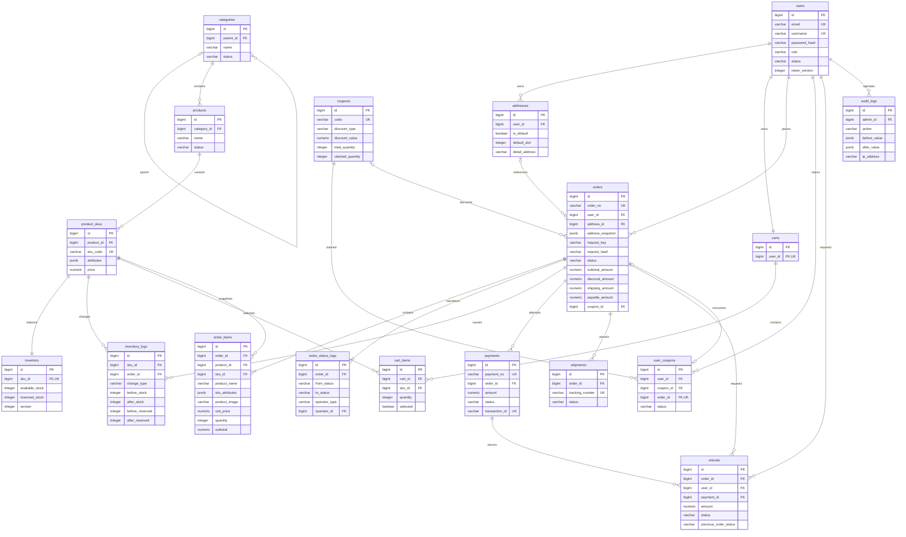

# OrderHub V1 数据库设计

V1 使用 18 张核心表。旧版六表保留，其中原 inventory 改名为 legacy_inventory。V3 将升级时的旧账号、分类、商品、库存、购物车、订单和明细一次性复制到新模型；两套模型后续不双写。

迁移顺序：V1 原始演示表 → V2 新模型 → V3 导入旧数据 → V4 多包裹。不要修改已执行的迁移文件，后续变更追加版本。



完整字段、外键和 CHECK 以 src/main/resources/db/migration/V2__commerce_v1.sql 为准。金额采用 NUMERIC(12,2) / BigDecimal。Excel 金额写为十进制字符串以保留精度。

## 关键约束

- 地址通过 UNIQUE(user_id,default_slot) 和 CHECK 保证最多一个默认地址；非默认地址 default_slot 为 NULL。修改默认地址锁用户行。删除地址后订单外键设 NULL，地址快照保持。
- 一个用户一个购物车，一个 SKU 一条库存。购物车 (cart_id,sku_id) 唯一；重复添加累加数量，单 SKU 最多 999 件、购物车最多 100 种 SKU。
- 订单 (user_id,request_key) 唯一，另保存请求体 SHA-256。相同键不同请求体返回 409；同一请求重试返回原订单。
- 一个订单支持多次支付尝试。先锁订单，再处理支付结果，成功后关闭其他 PENDING 尝试。
- 每用户每种优惠券只能领一次，领取总数不超过发放量。USED 必须关联订单；取消或模拟退款后释放，过期则为 EXPIRED。
- 商品与 SKU 下架保留历史外键。分类有子分类或商品时禁止删除，重新指定父分类不能形成环。
- 一单可有多个包裹，全部包裹 DELIVERED 后，订单才进入 DELIVERED。

## 库存与事务

下单把可售转为预占；未付款取消或未发货退款把预占转回可售；收货完成扣除预占。发货后不支持直接退款。

下单先锁用户行；其他订单操作先锁订单。随后统一按商品 ID 升序锁 SPU、按 SKU ID 升序锁 SKU，再修改库存，避免反转锁顺序。

```sql
UPDATE inventory
SET available_stock = available_stock - :qty,
    reserved_stock = reserved_stock + :qty,
    version = version + 1,
    updated_at = CURRENT_TIMESTAMP
WHERE id = :inventoryId
  AND version = :expectedVersion
  AND available_stock >= :qty;
```

影响行数必须为 1。余额、库存流水、订单、商品与地址快照、状态历史、优惠券占用和购物车清理在同一事务中提交，任意失败整单回滚。管理员调库存提交数量增量和 expectedVersion，版本过期返回 409。

## 索引与查询

| 查询 | 索引 |
| --- | --- |
| 分类、上架商品 | products(category_id,status,id)、products(status,id) |
| 商品 SKU、价格 | product_skus(product_id,status,id)、product_skus(status,price,id) |
| 用户订单分页 | orders(user_id,created_at DESC,id DESC) |
| 用户订单状态分页 | orders(user_id,status,created_at DESC,id DESC) |
| 后台订单与超时扫描 | orders(status,created_at,id) |
| 自动收货扫描 | orders(status,delivered_at,id) |
| 明细、支付、包裹 | order_items(order_id,id)、payments(order_id,id)、shipments(order_id,id) |
| 库存流水 | inventory_logs(sku_id,created_at DESC,id DESC) |
| 状态历史 | order_status_logs(order_id,created_at,id) |
| 用户优惠券与过期扫描 | user_coupons(user_id,status,expire_at)、user_coupons(status,expire_at,id) |
| 管理审计 | audit_logs(admin_id,created_at DESC,id DESC) |

价格筛选使用带参数的 EXISTS，避免把所有 SKU 读入 Java。价格排序按最低启用 SKU 价格。深分页仍有 OFFSET 成本，名称 LIKE '%keyword%' 不保证利用 B-tree；数据增长后可评估 pg_trgm，没有宣称百分比性能提升。

旧版设计和请求示例保存在 legacy-database.md、legacy-requests.http；旧 explain.sql 也仅适用于原演示表。
