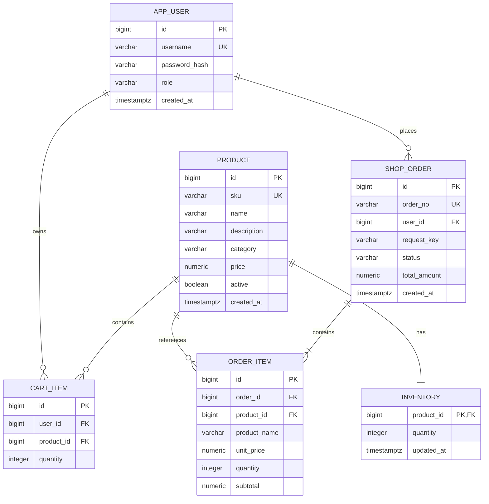

# 数据模型与 SQL 查询

迁移脚本：`src/main/resources/db/migration/V1__schema.sql`。应用启动时由 Flyway 创建表并维护版本，已执行的迁移不要修改，后续变更新增 V2、V3。

可复现的 PostgreSQL 模拟数据与执行计划脚本见 [explain.sql](explain.sql)，实际验证结果见 [verification.md](verification.md)。



`cart_item(user_id, product_id)`、`shop_order(user_id, request_key)` 和 `order_item(order_id, product_id)` 分别具有联合唯一约束。金额使用 NUMERIC / BigDecimal；库存非负、单价为正、购物车数量 1–999，明细小计必须等于单价乘以数量。商品下架使用 active 标记，保留历史外键和订单快照。

| 查询场景 | 索引 | 说明 |
| --- | --- | --- |
| 上架商品按分类分页 | product(active, category, id) | 等值筛选后按 id 倒序扫描 |
| 全部上架商品分页 | product(active, id) | 无分类条件时使用 |
| 当前用户历史订单 | shop_order(user_id, created_at DESC, id DESC) | 同一时间的订单用 id 保证稳定排序 |
| 按状态查历史订单 | shop_order(user_id, status, created_at DESC, id DESC) | 匹配用户、状态及排序 |
| 购物车、订单明细 | 联合唯一约束生成的索引 | user_id / order_id 是最左列 |

商品名称使用 LIKE '%keyword%'，普通 B-tree 无法高效处理这一条件。数据增长后可评估 PostgreSQL pg_trgm GIN 索引；当前没有把模糊检索宣称为索引优化成果。分页使用 MyBatis-Plus 分页插件，每页最多 100 条，深分页仍有 OFFSET 扫描成本。购物车最多 100 种商品，批量读取商品，避免逐项查询；订单历史页不逐单加载明细。

在有代表性的数据量上执行以下查询，观察扫描方式、实际行数与执行时间。小数据集选择顺序扫描是合理行为，项目不预设性能提升比例。

```sql
ANALYZE product;
ANALYZE shop_order;
EXPLAIN (ANALYZE, BUFFERS)
SELECT * FROM product
WHERE active = TRUE AND category = 'electronics'
ORDER BY id DESC LIMIT 20 OFFSET 0;

EXPLAIN (ANALYZE, BUFFERS)
SELECT * FROM shop_order
WHERE user_id = 1 AND status = 'CREATED'
ORDER BY created_at DESC, id DESC LIMIT 20 OFFSET 0;
```

下单先锁用户行，串行化同一用户的购物车修改与结算，再按 product_id 升序锁商品并执行条件扣减：

```sql
UPDATE inventory
SET quantity = quantity - :quantity, updated_at = CURRENT_TIMESTAMP
WHERE product_id = :productId AND quantity >= :quantity;
```

影响行数必须为 1，否则抛出业务异常并回滚整笔订单。商品编辑、库存调整和取消订单也遵守商品行锁与商品 ID 顺序，避免锁顺序反转。取消先锁订单，已取消则直接返回。所有订单读取与取消查询都包含当前 JWT 的 user_id，客户端不传用户 ID。
