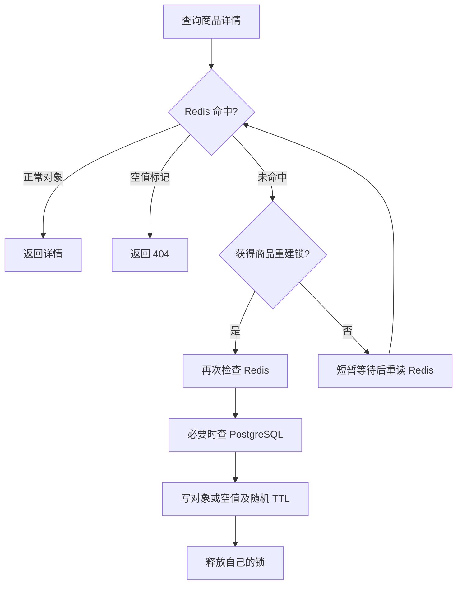

# Redis 缓存与限量优惠券并发设计

## 缓存穿透、击穿、雪崩

| 问题 | 具体触发 | 本项目的处理 |
| --- | --- | --- |
| 穿透 | 同一个不存在的商品被反复查询 | 在商品原 key 写空值标记，缓存 60–75 秒；命中直接返回 404，不再查询商品表 |
| 击穿 | 热点商品缓存刚好失效，大量请求同时回源 | product:lock:商品ID 互斥重建，获取锁后再次检查缓存；其他请求短暂等待并重读缓存 |
| 雪崩 | 一批商品 key 同时过期 | 正常商品 TTL 为 30 分钟 + 0–5 分钟随机值，空值 TTL 也单独加随机值 |

空值标记为 `~orderhub:product:not-found:v1~`，使用与正常详情相同的 key，例如 `product:100`。创建、修改、上架、下架仍在事务提交后删除该 key，因此新增商品不会长期被旧的空值挡住。数据库异常不当作商品不存在缓存。



默认锁租期 10 秒，等待最多 2 秒，每次等待约 25–35 毫秒。等待超时返回 503，请求可重试，不在 Redis 正常但锁忙时绕过锁打数据库。Redis 连接故障则降级读数据库。

锁使用随机令牌。发布缓存和释放锁均通过 Lua 核对令牌，过期的旧持有者不能覆盖新缓存，也不能删除新持有者的锁。数据库加载成功后若写 Redis 失败，直接返回已加载结果，不重复查库。

实现：`product/cache/ProductDetailCache.java`。此互斥只应用于公开商品详情；SKU 列表等原有缓存继续使用 Cache Aside。缓存是最终一致的，结算价格和库存仍读数据库。

## Redisson 的使用范围

订单库存继续保留数据库事务、FOR UPDATE、version 条件更新与非负约束，没有用 Redis 锁替换库存方案。

限量优惠券使用 Redisson 4.8.0 的 RLock：

```text
coupon:claim:{优惠券ID}:用户ID    同一用户重复领取互斥
coupon:init:{优惠券ID}          冷启动快照初始化互斥
```

同一用户的锁从 Lua 预扣前一直持有到数据库事务提交后。数据库写入放在独立的 `CouponClaimStore` Spring Bean，使用 REQUIRES_NEW，避免同类内部调用绕过事务代理、或事务还没提交就释放锁。tryLock 等待默认最多 2 秒；不指定固定 leaseTime，使用 Redisson watchdog 续期，最终只由当前持有线程释放。

两个不同用户不争同一把领取锁，可同时进入 Lua；数据库仍会在最终写入时串行化同一券的限量计数更新。

## Lua 抢券及数据库落地

接口沿用：`POST /api/v1/user/coupons/{couponId}/claim`，无需改变调用方。

| Redis key（以券 ID 100 为例） | 类型与用途 |
| --- | --- |
| coupon:state:{100} | HASH，活动状态、时间范围及当前 generation |
| coupon:stock:{100} | STRING，Redis 剩余预筛名额 |
| user:coupon:{100} | SET，已领取或正在预扣的用户 ID |
| coupon:pending:{100} | HASH，用户 ID → 本次预扣随机令牌 |
| coupon:pending-expiry:{100} | ZSET，用户 ID → 预扣恢复截止时间 |
| coupon:epoch:{100} | STRING，失效代次，阻止旧数据库快照回填 |

领取集合含内部哨兵 `__initialized__`，用于区分“还没有人领”和“整个集合被淘汰”。实际人数不要直接按 SCARD 计算，应排除哨兵；准确业务人数查询 PostgreSQL。

冷启动或 Redis 状态丢失时，在初始化锁下使用同一个 PostgreSQL REPEATABLE READ 快照读取活动剩余数量和已领取名单，再一次性初始化 Redis。用户 ID 以字符串传给 Lua，避免 Lua/cjson 数值精度丢失 BIGINT。管理员改券或启停在提交后失效，epoch 防止并发中的旧快照重新写回。

领取 Lua 单次执行完成：

1. 检查状态是否完整、generation 是否匹配。
2. 检查用户是否已在领取集合中。
3. 使用 Redis TIME 检查活动是否启用且处于领取时段。
4. 检查剩余名额大于 0。
5. 库存减 1、记录用户、写入预扣令牌及恢复截止时间。

返回码：0 预扣成功、1 重复、2 领完、3 未到时间/过期/停用、4 需要重建。重复请求查询数据库后返回同一张用户券，不再次扣减。

接着同步执行 PostgreSQL 事务：验证账号 → 锁用户和优惠券 → 检查已领取 → 验证活动 → 条件增加 claimed_quantity → 插入 user_coupons。数据库仍保留 `(user_id,coupon_id)` 唯一约束和 `claimed_quantity <= total_quantity` 的 CHECK / 条件 UPDATE，作为不超发、不重复的最终保障。

## 失败、重试和恢复

- 数据库提交成功：确认预扣，移除 pending，保留领取集合和已扣名额，然后释放 Redisson 锁。
- 数据库失败：整个数据库事务回滚；Lua 仅补偿匹配本次随机令牌的预扣，随后失效活动镜像，使下一次从数据库恢复准确余额。
- 进程在预扣后崩溃：watchdog 停止后锁会到期；预扣默认 2 分钟后可恢复，任务每分钟处理最多 200 个。恢复前也要获取同一用户锁，跳过仍在处理的请求。
- 恢复时数据库已有领取记录：确认预扣，不增加库存。数据库没有记录：释放名额并移除用户，允许重试。用户重试发现遗留预扣时也会主动核对，不必等待定时任务。
- Redis / Redisson 故障：退回数据库原有事务逻辑，后续失效或重建 Redis。Redis 预扣失败不表示数据库已经发券，业务成功必须以数据库提交为准。
- 旧令牌、旧 generation 不能补偿新请求；Redis 超时但执行结果未知时，也依靠数据库及后续核对收敛。

Redis Lua 只保证 Redis 内原子性，不与 PostgreSQL 组成分布式强事务。此实现选择同步数据库落地、数据库兜底和可恢复预扣，而非异步发券。极端故障期间可能暂时少显示名额，恢复后收敛；不会把 Redis 结果直接宣称为最终发券成功。

当前应用连接单机 Redis。优惠券脚本所有 key 使用同一 `{couponId}` hash tag；若将整套部署迁移为 Redis Cluster，还需修改客户端配置与商品缓存脚本的键分布，不能只切换 Redis 地址。

## 配置与验证

商品配置前缀 `orderhub.cache.product`：ttl、ttl-jitter、null-ttl、null-ttl-jitter、lock-ttl、wait-timeout、retry-interval。优惠券配置：`orderhub.coupon.lock-wait`、reservation-timeout、recovery-delay-ms。

`COUPON_REDIS_ENABLED=false` 可单独关闭抢券 Redis 优化，保留数据库领取功能；默认跟随 CACHE_ENABLED。TASKS_ENABLED=false 会暂停定时恢复，但同一用户重试仍可主动核对遗留预扣。配置均有默认值，无需更改现有 .env。

Redis 查询示例（默认 DB 0，ID 换成实际优惠券 ID）：

```powershell
docker compose exec redis redis-cli GET 'coupon:stock:{100}'
docker compose exec redis redis-cli SMEMBERS 'user:coupon:{100}'
docker compose exec redis redis-cli HGETALL 'coupon:pending:{100}'
docker compose exec redis redis-cli PTTL 'product:100'
```

测试仍使用 README 的 `mvnw -Pv1-integration verify`，独立 PostgreSQL 测试库和 Redis DB 1。覆盖并发单次回源、重复不存在商品 SQL 次数、空值失效、TTL 范围、旧缓存锁令牌、32 个请求争抢 5 个 Lua 名额、两个独立 Redisson 客户端、数据库真实回滚、Redis 故障兜底及中断预扣恢复。不把这些正确性测试当作吞吐压测结果。

参考：[Redisson 锁与 watchdog](https://redisson.pro/docs/data-and-services/locks-and-synchronizers/index.html)、[Redis Lua 原子执行](https://redis.io/docs/latest/develop/programmability/eval-intro/)、[Redis Lua API 与多 key 限制](https://redis.io/docs/latest/develop/programmability/lua-api/)。

本次实际测试数量与容器验证结果见 [redis-verification.md](redis-verification.md)。
